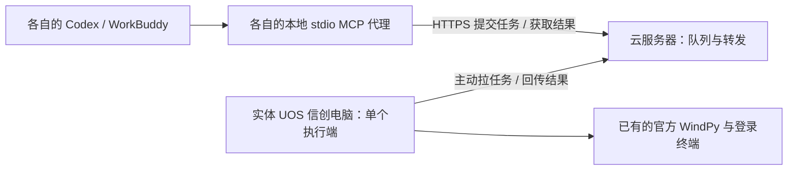

# WindPy 云端转发试验

这是独立的试验模块，基于原有 0.24.2 工具接口。原来的 `server.py` 和 `wind_bridge/` 不需要改动，原有本地 MCP 可继续使用。

**当前验收：本机模拟通过；云服务器、UOS 实机和真实 WindPy 尚未验收。** `relay_demo.py` 禁止导入 WindPy，模拟结果标为 `relay_mock`。不要把模拟验收报告当成真实取数结果。

## 三台机器分别做什么



执行端可以是已稳定运行 WindPy 的 **UnionTech OS Desktop 20 Pro GNU/Linux**，无需换成 Windows。它主动向云端发起连接，不需要开放信创电脑的入站端口。

| 位置 | 入口 | 是否需要 WindPy |
| --- | --- | --- |
| 云服务器 | `relay_gateway.py` | 否 |
| 实体 UOS 电脑 | `relay_worker.py` | mock 不需要；native 复用已有 SDK |
| 每个人的电脑 | `relay_client.py`，由 harness 启动 | 否 |

本地代理保留 26 个原有工具，增加 `relay_status`、`relay_job_status`、`relay_cancel_job`。慢任务通常先返回任务编号，模型应查询同一编号，不能重复提交取数任务。

## 1. 准备文件和访问地址

试验增量包只包含转发模块、工具契约、说明、测试及依赖清单，不覆盖原有核心文件。云端和客户端可以把它解压到独立目录；**UOS 执行端需把增量文件放入原有 0.24.2 代码目录**。如果执行端 `server.py` 与工具契约的 SHA256 不同，会停止并报 `CONTRACT_MISMATCH`，此时先核对版本，不要跳过检查。

三端推荐 Python 3.12，支持 Python 3.10+。UOS 复用原来能运行 WindPy 的 venv。云端和各客户端可以单独创建 venv，再安装 `requirements.lock.txt`；不要在这些机器上运行原有 `install.py`，它会检查本机 Wind SDK。

Linux/macOS 示例：

```sh
python3 -m venv .venv
.venv/bin/python -m pip install -r requirements.lock.txt
```

Windows 示例：

```powershell
py -3 -m venv .venv
.\.venv\Scripts\python.exe -m pip install -r requirements.lock.txt
```

云端需要一个三端都能访问的 HTTPS 地址，例如 `https://relay.example.com`，指向云端网关。**`47.111.101.66:3389` 是远程桌面地址，不能作为本接口的地址。** 只有 RDP 凭据还不能确定 API 端口是否可用，需要核实已有 HTTPS 入口或云端网络权限。

网关默认只监听 `127.0.0.1:8765`，可接在已有 HTTPS 反向代理之后。如果三端已有加密的私有组网，可使用私有地址加 `--allow-private-http`；不能在公网明文 HTTP 上传递凭据。无需改变远程桌面端口、重启服务器或替换服务器上已有程序。

## 2. 一次生成凭据，分别分发

在受控机器上使用实际地址，替换示例域名和用户编号：

```sh
.venv/bin/python relay_setup.py init --output .relay --url https://relay.example.com --clients owner colleague1
```

输出目录必须为空，避免意外覆盖已有凭据。命令只显示保存位置，不打印 token。

| 配置文件 | 交给谁 |
| --- | --- |
| `.relay/gateway.json` | 只交给云端，内含 token 哈希 |
| `.relay/worker.json` | 只交给 UOS 执行端 |
| `.relay/client-owner.json` | 只交给 owner 本人 |
| `.relay/client-colleague1.json` | 只交给 colleague1 本人 |

不要把整个 `.relay` 目录发给所有人，不要把配置提交到 Git。文件中的相对数据路径按**配置文件所在目录**解析，配置可移到目标机器；本地 MCP 的 Python 和脚本路径则要在目标机器重新生成。

## 3. 先启动云端网关

Linux/macOS：

```sh
.venv/bin/python relay_gateway.py --config .relay/gateway.json
```

Windows：

```powershell
.\.venv\Scripts\python.exe relay_gateway.py --config .relay\gateway.json
```

把已有 HTTPS 入口转发到这个进程。初次试验以前台方式运行，关闭该进程即可停止；本试验不自动安装系统服务或调整防火墙。

## 4. UOS 先运行 mock 执行端

在原有 MCP 目录中，使用已稳定运行的 venv Python：

```sh
.venv/bin/python relay_worker.py --config .relay/worker.json --mode mock
```

不传 `--mode` 也默认 mock。这个模式只导入原来的工具定义，使用合成上游；不会启动原来的 MCP stdio 服务，不会导入真实 WindPy，不会写入已有生产数据目录。

每个执行目录只运行一个转发执行端，跨客户端任务由云端串行排队。开始真实取数后，执行端仍复用原来的每次调用子进程和原生调用锁。

## 5. 各自生成本地 MCP 配置

在每个人自己的机器、自己的解压目录中执行。下面的 Python 路径会保留当前 venv，不会沿用发包者的路径：

```sh
.venv/bin/python relay_setup.py client-config --config .relay/client-owner.json --format codex
```

WorkBuddy 换为：

```sh
.venv/bin/python relay_setup.py client-config --config .relay/client-owner.json --format workbuddy
```

Windows 将 Python 路径换为 `.\.venv\Scripts\python.exe`。生成的内容只包含 Python、脚本和配置文件路径，不打印 token；按客户端格式合并 `wind_terminal_relay` 条目，保留其他设置，再重载此连接。

Codex 本地 stdio 配置与超时参数依据 [官方 MCP 文档](https://developers.openai.com/codex/mcp)。脚本不会自行修改任何 harness 的设置。

给模型的第一次试验指令：

```text
只使用 wind_terminal_relay。先调用 relay_status，确认 worker_mode=mock。
以 query_wind_data 查询 edb：codes=S0033227，beginTime=2026-01-01，endTime=2026-01-04，options=""。
如果返回 result_ready=false，用 relay_job_status 查询同一个 job_id，不要重新提交。
展示实际返回的来源标识、日期、值和 receipt_id，明确这是 relay_mock 合成测试数据。
```

`worker_online=true` 只表示近期通信正常，不代表 Wind 已登录。`state=completed` 表示执行端已回传结果，要继续检查结果本身的 `ok` 和错误信息。

## 6. mock 验通后再决定真实验收

当前默认停留在 mock 阶段，遵守“不启动真实 Wind MCP”的要求。切换 native 会允许代理请求触发官方 WindPy，应在确认需要实测后单独进行：

```sh
.venv/bin/python relay_worker.py --config .relay/worker.json --mode native
```

native 复用已有 SDK 路径、环境变量和登录会话。若原有 MCP 设置了 `WIND_TERMINAL_MCP_DATA_DIR`，需沿用该值，或在 `worker.json` 中填写对应的 `shared_profile` 绝对路径，使本地普通 MCP 和转发执行端共用原生锁与请求预算。`mcp_root` 可指定已有核心代码目录，但必须与工具契约匹配。不要打印整个配置或把凭据写入启动参数。

各客户端的回执、缓存和指标观察写入独立目录，共享目录只用于预算与原生调用锁。**试验不会自动复制原有指标目录**，新用户的指标目录初始为空，首次实测优先用已知代码。原始数据保留 `wind_terminal_api`、原始上游 `source`、参数、日期、单位和空值状态。

native 与原有本机 MCP 同时取数时，共享锁可能让其中一方返回 `WIND_BUSY`，需等待当前查询结束；mock 阶段不占用生产原生锁。共享预算只统计本项目预算感知版本的调用，不能替代 Wind 账户真实配额。

尚需在目标机器完成：一个小范围已知代码查询、原始回执读取、两个客户端排队与隔离、执行端断线后的结果补传。完成这些之前，不能声称多人真实 WindPy 访问已验收。

## 恢复与停止

- 未执行任务可以取消；已开始的任务不会因客户端取消而终止或自动重跑。
- 开始执行后断线，只补传已经保存的结果。若进程中断且没有保存结果，会留下 `inflight.json`，并暂停新任务。
- 云端租约到期的已开始任务标为 `uncertain`，不再自动派发。确认原执行进程已经结束并核对结果后，可在云端使用 `relay_gateway.py --config ... --resolve-uncertain <job_id>` 将它标为失败。该命令不重跑任务；执行端的中断标记也需核对后手动归档。
- Wind 配额错误会留下 `halt.json` 并暂停新任务，确认配额恢复后再处理标记。
- 只有本次执行失败且含配额错误时才暂停。成功的能力说明、状态检查和回执读取可能包含历史配额错误，这些历史记录不会触发停机。
- 排队超过 30 分钟的任务过期；云端已结束任务的结果保留 24 小时，任务编号的去重记录继续保留。实体电脑上的回执按原有保存方式保留。
- 初次试验使用前台进程，停止试验进程即可。UOS 电脑需保持开机、网络连接和原有可用的 Wind 环境。

## 本地复验

这些复验需在有完整 0.24.2 核心代码的目录中运行，不适用于只解压了转发增量的云端/代理目录。

```sh
.venv/bin/python -m unittest discover -s tests -p test_relay.py -v
.venv/bin/python verify_relay_offline.py
.venv/bin/python relay_demo.py
.venv/bin/python relay_demo.py --network
```

最后一条会在本机临时启动回环 HTTP 网关和两个 stdio MCP 代理，并在结束后关闭它们。上述命令都不导入真实 WindPy，不连接已安装的真实 Wind MCP。全套离线测试的明细与摘要保存到 `verification/relay-offline-suite.txt/json`，模拟验收记录在 `verification/relay-*-acceptance.json`。

`build_relay_trial.py` 单独生成 `dist/wind-terminal-mcp-relay-trial-v1.zip`，其中不包含已有核心代码、SDK、生产数据或凭据；不会替换原来的正式发布包。
